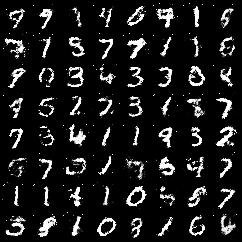

# GAN from Scratch

My implementation of the original GAN paper, [*Generative Adversarial Nets*](https://arxiv.org/abs/1406.2661) (Goodfellow et al., 2014), trained on MNIST handwritten digits.

This is the first project in a series where I'm reading the big AI papers and building each model myself to understand how they actually work.



*Digits generated by the model after 50 epochs of training.*

## How it works

A GAN is two neural networks competing against each other:

- **The generator** takes random noise and tries to turn it into a realistic-looking digit.
- **The discriminator** looks at an image and guesses whether it's real or fake.

The discriminator gets better at spotting fakes, which forces the generator to make better fakes. Over time, the generator learns to produce digits that look real.

## What went wrong (and how I fixed it)

My first attempts didn't work. The discriminator won almost immediately: it became 100% confident about every image, so the generator stopped getting any useful feedback.

When I looked closer, the generator was producing **almost the same image every time**, no matter what noise I gave it. This is called **mode collapse**, and it made the discriminator's job way too easy.

Adding dropout to the discriminator didn't fix it. What did:

- Switching the generator's activations from **ReLU to LeakyReLU**
- Switching its output from **sigmoid to tanh** (and scaling the images to match)

After that, the two networks stayed balanced and the generator started producing a wide variety of digits.

## Changes from the paper

I kept the paper's network sizes but used some modern training choices that are more stable: the Adam optimizer, LeakyReLU, and a tanh output. The original paper used SGD, maxout layers, and a sigmoid output.

## Files

```
data.py      # loads MNIST
models.py    # the generator and discriminator
train.py     # training loop
samples/     # generated digits after each epoch
```

## Run it

```bash
python -m venv myenv
source myenv/bin/activate
pip install -r requirements.txt
python train.py
```

MNIST downloads automatically the first time. Generated images are saved to `samples/` after every epoch, so you can watch the digits form.

## What I learned

- GANs fail quietly. Nothing crashes, the numbers just drift, so you have to check what the model is actually producing.
- The two networks need to stay balanced. If one gets too strong, neither learns.
- Small details in a paper, like activation functions, can decide whether training works at all.
